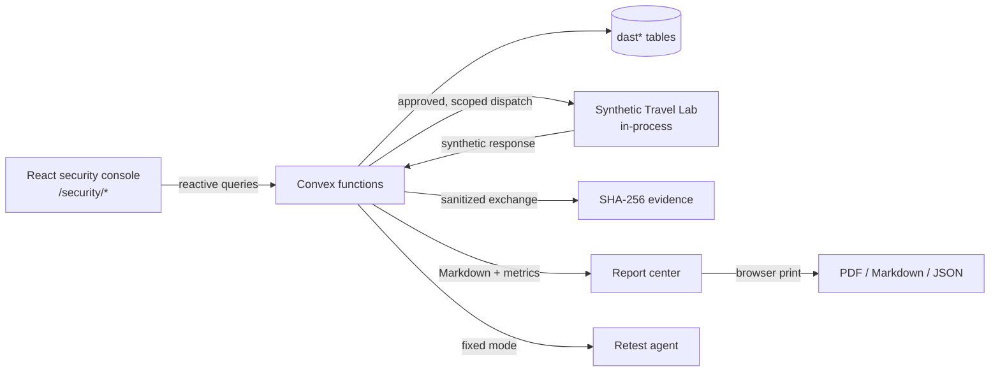
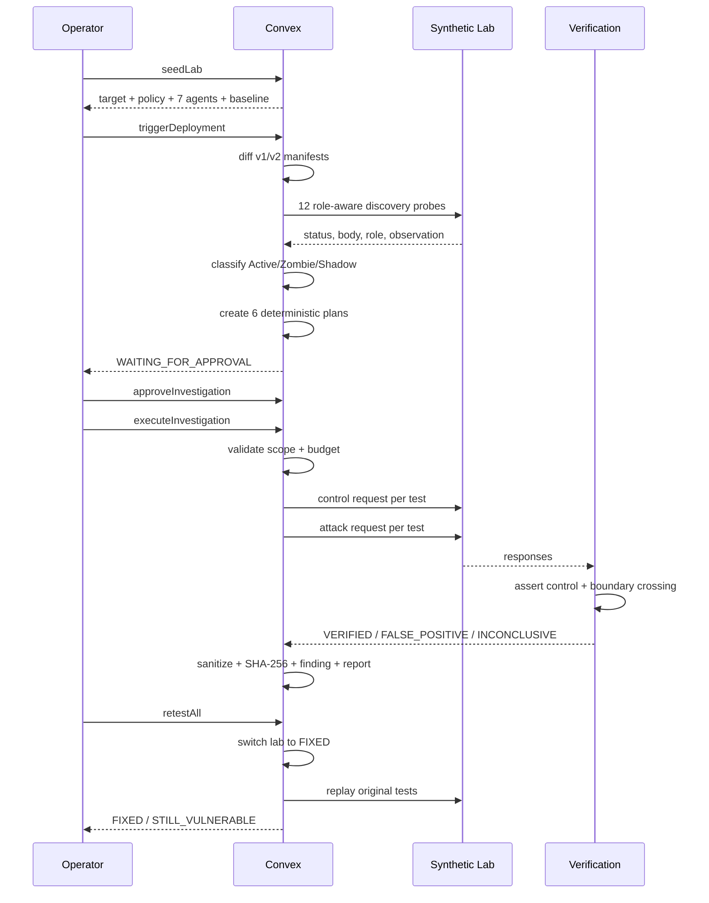

# JAAL Agentic DAST — Architecture

## Runtime boundaries

The original forensic tables (`investigations`, `evidence`, `reports`, `messages`, `tactics`, …) are not read or modified by this module. DAST ownership is the stable Convex Auth user ID, and every query/mutation checks it server-side.

External staging execution is deliberately disabled. See [`DAST_EXTERNAL_EXECUTION_DESIGN.md`](DAST_EXTERNAL_EXECUTION_DESIGN.md) for the worker boundary, authorization workflow, SSRF/DNS-rebinding controls, queue semantics and enablement gates that must be implemented and tested before any outbound target is allowed.

## Investigation sequence

## Data model

| Table | Purpose | Key indexes |
|---|---|---|
| `dastApplications` | Lab/staging application scope | `by_owner` |
| `dastTargets` | Exact host/path allowlist | `by_owner`, `by_application` |
| `dastPolicies` | Budgets, approval, emergency stop | `by_owner`, `by_application` |
| `dastAgents` | Seven persisted agent definitions | `by_owner_application`, `by_application_key` |
| `dastDeployments` | Release manifest + changes + idempotency | `by_application_version`, `by_application_idempotency` |
| `dastEndpoints` | Discovered inventory + classification | `by_application_path`, `by_application_classification` |
| `dastObservations` | Per-probe request/response summaries | `by_application_observed`, `by_endpoint` |
| `dastFlows` | Business workflow relationships | `by_application_key` |
| `dastInvestigations` | Case, stage, safety, stats | `by_owner_application`, `by_owner_status` |
| `dastPlans` | Bounded, validated attack plans | `by_investigation` |
| `dastApprovals` | Human decision record, plan/scope SHA-256 digests, expiry and consumption | `by_investigation_status` |
| `dastExecutions` | Control + attack assertions | `by_investigation` |
| `dastFindings` | Verified findings + remediation + retest state | `by_investigation`, `by_finding_id` |
| `dastEvidence` | Sanitized artifact + SHA-256 | `by_finding`, `by_owner_created` |
| `dastReports` | Immutable Markdown report snapshots | `by_investigation` |
| `dastRetests` | Fixed-config replay outcomes | `by_finding`, `by_owner` |
| `dastAudit` | Append-only operational audit | `by_owner_at`, `by_investigation` |
| `dastJobs` | Durable job/lease/attempt records | `by_investigation` |

## Safety boundary

1. **Plan validation** — method ∈ {GET, POST}, HTTPS only, exact host allowlist, `/api/*` scope, budget 1–20 per plan.
2. **Approval** — `executeInvestigation` refuses unless an `APPROVED` row exists, its canonical SHA-256 plan and scope digests still match, it has not expired, and it has not already been consumed. New approvals use sorted-key canonical JSON (`digestVersion: 2`); a legacy v1 path exists only to recognise pre-migration approvals. Policy or lab-configuration changes expire open approvals. Approval is consumed before the first test, so a successful run cannot be replayed.
3. **Emergency stop** — checked before deployment-triggered runs and before execution; waiting investigations are cancelled.
4. **Server-side only** — frontend controls call authenticated mutations; no target URL is accepted from an untrusted plan.
5. **No arbitrary LLM execution** — the planner selects from a finite catalogue; no generated URL, method or payload is dispatched.
6. **Evidence sanitation** — redaction runs recursively through nested bodies, headers and arrays. Emails and PNR fields are masked; authorization, cookie, token, password, secret, API key, session and CSRF fields are redacted; bearer/JWT/key-shaped strings and `session=`/`csrf=`/`xsrf=` values are redacted inside free text. The stored canonical JSON is the exact text hashed with SHA-256.
7. **Budget preflight** — a plan is blocked before dispatch when its declared request count cannot fit the plan or remaining run budget. Actual request counts are checked again after execution.
8. **Concurrency** — only one concurrent execution attempt can consume an approval; repeated retests skip findings already marked `FIXED`, so retest evidence is not duplicated.

## Verification contract

A test is `VERIFIED` only if:

- the control request returns the expected authorized result, **and**
- the attack request demonstrates the specific boundary violation (wrong agency data, privileged write accepted, tampered fare accepted, duplicate refund, unauthenticated traveler data, or cross-agency metrics).

Otherwise the execution is recorded as `FALSE_POSITIVE` or `INCONCLUSIVE`; it never becomes a finding.
